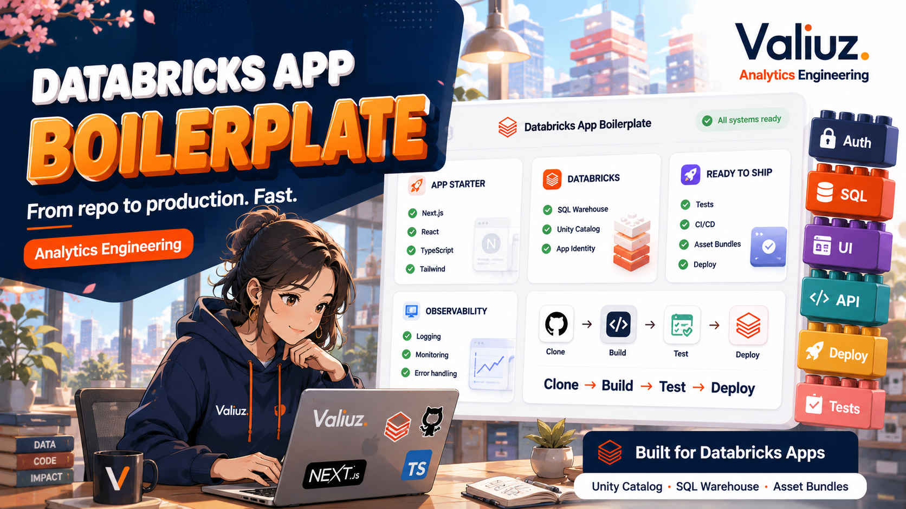

# Databricks App Template



Golden path Next.js/TypeScript pour construire des Databricks Apps analytics. Il fournit un shell UI Valiuz, une
configuration validée, une couche Databricks SQL centralisée, des erreurs publiques sûres, des logs structurés, des
tests et un déploiement reproductible avec Databricks Asset Bundles.

## Quick Start

Prérequis : Node.js 22.16+, npm et Git. Aucun accès Databricks n’est requis pour le mode démo.

```bash
git clone https://github.com/valiuz/analytics_dbx_app_template.git my-new-app
cd my-new-app
npm ci
npm run init-app -- my-new-app
npm run app:guide
npm run app:doctor
npm run dev
```

Ouvrir <http://localhost:3000>. Le mode démo est explicite et n’effectue aucun appel distant.

## Parcours guidé pour une app interne

Le parcours reste volontairement léger pour une app maintenue par une seule personne :

1. `npm run app:guide` consigne utilisateurs, décision et succès attendu dans `config/app-spec.yml` et synchronise
   `docs/product-brief.md`.
2. `npm run data:init -- <nom>` choisit `direct`, `notebook` ou `pipeline`. Utiliser `direct` tant qu'une table ou vue
   existante suffit.
3. `npm run feature:new -- <slug>` crée une première tranche verticale : page, carte KPI, route, service, repository,
   requête paramétrée, fixture démo et tests.
4. `npm run app:doctor` indique la prochaine action utile. `npm run check` valide ensuite l'ensemble localement.

Exemple minimal après avoir confirmé une table existante :

```bash
npm run data:init -- ventes \
  --mode direct \
  --source dev-dtm-media-pm.analytics.ventes \
  --non-interactive
npm run feature:new -- ventes-du-jour
```

Les commandes interactives demandent une information à la fois. Elles n'accèdent pas au workspace et ne déploient
rien.

## Identité Valiuz et support

Le shell reprend le « V » et la palette Valiuz utilisés par l'app FRAIM. Le même SVG sert de logo dans le header et de
favicon dans l'onglet. Le nom, la description et le contact Slack sont propres à chaque app et sont demandés par
`init-app`. Les tokens, règles de composants et usages data visualisation issus de la charte 2026 sont résumés dans
[le design system analytics](docs/design-system.md).

Le contact reste volontairement simple : un lien HTTPS vers un profil ou un canal du workspace Valiuz. Par défaut,
le lien ouvre directement le profil Slack d'Alexis, comme dans FRAIM. Il peut être remplacé de manière interactive ou
avec :

```bash
npm run init-app -- <nom> \
  --support-name "Prénom ou équipe" \
  --support-slack-url "https://valiuz.slack.com/team/<identifiant>"
```

Ne pas coder un contact personnel en dur dans un composant métier. Modifier `APP_SUPPORT_NAME` et
`APP_SUPPORT_SLACK_URL` via l'initialisation afin que le support reste visible et cohérent dans toutes les pages.

## Workflows d'assistance

Le repository fournit des workflows compatibles avec le standard ouvert Agent Skills :

| Skill | Usage |
| --- | --- |
| `create-analytics-dbx-app` | Créer le repository Valiuz, initialiser le clone, découvrir les sources Databricks et cadrer progressivement KPI, requêtes et fonctionnalités |
| `github-engineer` | Isoler une tâche dans une branche ou un worktree, publier une pull request et nettoyer prudemment le travail fusionné |
| `review-analytics-app-docs` | Comparer README, runbooks, manifests et workflows au code et à la configuration réels |
| `test-analytics-app-e2e` | Planifier, écrire et diagnostiquer des parcours Playwright reproductibles en mode démo |
| `validate-analytics-kpis` | Vérifier les contrats de données, calculs, risques statistiques et représentations des KPI |

Depuis un checkout du template, demander à l'assistant d'utiliser le skill correspondant. Le bootstrap pose au maximum
trois questions à la fois. Toute mutation GitHub ou Databricks demande une autorisation explicite.

## Infrastructure Valiuz préremplie

Le bootstrap propose les valeurs partagées déjà utilisées par l’app FRAIM :

| Ressource | Valeur par défaut |
| --- | --- |
| Workspace Databricks | `https://3070470996474403.3.gcp.databricks.com` |
| SQL Warehouse | `team-da-poc` (`ab362e9710498a08`) |
| Permission du binding warehouse | `CAN_USE` |

Chaque application choisit aussi un projet de données, représenté par son catalogue Unity Catalog. Les valeurs
autorisées sont `dev-dtm-operating`, `dev-dtm-media-pm`, `dev-dtm-myvaliuz` et `dev-dtm-insight-sharing`.

Avec `npm run init-app -- <nom>`, accepter ces deux valeurs pour cibler l’infrastructure partagée, ou utiliser
`--host` et `--warehouse` pour les remplacer. Le projet/catalogue, le schema et les groupes d’accès restent propres à chaque
application. `CAN_USE` sur le binding autorise l’identité de l’app à utiliser le warehouse ; les privilèges Unity
Catalog et l’accès des utilisateurs à l’app restent à configurer séparément.

## Configuration

`parseAppDisplayConfig` valide la configuration publique pendant le build. Le serveur valide la configuration
Databricks complète au démarrage dans `src/lib/config/server-config.ts`.

| Variable | Local démo | Local Databricks | Databricks Apps |
| --- | --- | --- | --- |
| `APP_MODE` | `demo` | `databricks` | `databricks` via `app.yaml` |
| `APP_NAME` / `APP_DESCRIPTION` | valeurs de l'app | mêmes valeurs | injectées via `app.yaml` |
| `APP_SUPPORT_NAME` | nom du contact ou de l'équipe | même valeur | injectée via `app.yaml` |
| `APP_SUPPORT_SLACK_URL` | URL HTTPS `valiuz.slack.com` | même valeur | injectée via `app.yaml` |
| `LOG_LEVEL` | `info` par défaut | même valeur | `info` via `app.yaml` |
| `DATABRICKS_HOST` | non | oui | injectée par Databricks au runtime, absente pendant le build |
| `DATABRICKS_CONFIG_PROFILE` | non | oui, recommandé | jamais utilisée |
| `DATABRICKS_TOKEN` | non | fallback uniquement | jamais utilisée |
| `DATABRICKS_CLIENT_ID` / `DATABRICKS_CLIENT_SECRET` | non | non | injectées par Databricks |
| `DATABRICKS_APP_NAME` | non | non | injectée par Databricks et active OAuth M2M |
| `DATABRICKS_SQL_WAREHOUSE_ID` | non | oui | binding `valueFrom` |
| `DATABRICKS_CATALOG` / `DATABRICKS_SCHEMA` | non | projet autorisé + schema | `app.yaml` |
| `DATABRICKS_SQL_TIMEOUT_MS` | 30 s par défaut | 60 s dans `.env.example` | 30 s par défaut |

Les tables et vues nécessaires sont déclarées dans `config/data-access.json`. Après chaque modification, exécuter
`npm run data:access:render`. Committer le manifeste avec `resources/data-access.generated.yml`. Ce fichier contient
la ressource app complète, le warehouse avec `CAN_USE` et chaque source avec `SELECT`.

Copier `.env.example` vers `.env.local`. Pour utiliser de vraies données, configurer un profil OAuth avec
`databricks auth login`, passer `APP_MODE` à `databricks`, puis exécuter `npm run databricks:check` et
`npm run test:databricks`. Le premier contrôle lit les métadonnées des sources déclarées ; le second vérifie réellement
`SELECT` sans retourner de ligne. Voir [docs/local-development.md](docs/local-development.md) pour le parcours complet.

### Préparer une table dédiée seulement si nécessaire

`npm run data:init` propose trois niveaux :

| Mode | Quand l'utiliser | Ressource distante ajoutée |
| --- | --- | --- |
| `direct` | une table ou vue existante convient | aucune |
| `notebook` | une sélection ou transformation batch simple doit être rejouée | un Lakeflow Job avec notebook SQL |
| `pipeline` | la préparation est incrémentale, planifiée ou doit produire une materialized view | une pipeline Lakeflow et son Job |

Les modes préparés créent un contrat sous `data/contracts/`, un SQL de départ avec colonnes explicites et un mini-bundle
séparé sous `data/`. Relire le SQL, puis lancer explicitement `npm run data:prepare -- <nom> --confirm` avant de
déployer l'app. Les schedules restent en pause par défaut. L'identité de préparation écrit la table ; l'identité de
l'app ne reçoit que `SELECT` sur la sortie.

## Commandes

| Commande | Usage |
| --- | --- |
| `npm run dev` | serveur local avec rechargement |
| `npm run lint` | lint Next.js/TypeScript |
| `npm run typecheck` | vérification TypeScript stricte |
| `npm test` | tests unitaires Node |
| `npm run build` | build standalone de production |
| `npm run check` | toutes les validations locales |
| `npm run app:guide` | cadre l'app et synchronise le brief produit |
| `npm run app:spec:check` | vérifie la spec et le brief |
| `npm run feature:new -- <slug>` | génère une tranche KPI complète à relire |
| `npm run data:init -- <nom>` | déclare une source directe ou prépare un starter notebook/pipeline |
| `npm run data:access:render` | valide le projet et génère les bindings des sources déclarées |
| `npm run data:access:check` | refuse un manifeste invalide ou un fichier généré obsolète |
| `npm run data:prepare:render` | régénère le mini-bundle depuis les contrats data |
| `npm run data:prepare:check` | vérifie les contrats et le mini-bundle de préparation |
| `npm run data:prepare -- <nom> --confirm` | déploie et exécute une préparation data distante |
| `npm run databricks:check` | préflight en lecture seule du profil, warehouse, projet, schema et sources |
| `npm run test:databricks` | smoke SQL réel sur les sources déclarées, hors CI |
| `npm run bundle:validate` | validation du bundle Databricks |
| `npm run bundle:compatibility` | validation des bundles initialisés avec le Databricks CLI installé, sans workspace distant |
| `npm run template:journey` | parcours complet dans une copie Git propre, avec installation et build de l'app générée |
| `npm run app:provision -- --target prod --profile <profil>` | crée les ressources sans démarrer l'app |
| `npm run app:smoke -- --app <app> --profile <profil>` | teste l'app déployée et ses accès SQL runtime |
| `npm run app:doctor` | affiche les contrôles locaux et la prochaine action |
| `npm run preview:real -- --profile <profil> --confirm` | déploie une preview dev et exécute les smokes |
| `npm run deploy -- --target dev --profile <profil>` | valide, déploie et démarre l’app |

`npm run deploy` modifie des ressources distantes. Vérifier le profil, le workspace, la target et les variables avant
de l’exécuter.

## Structure du repository

```text
src/app/                         pages, layouts et routes HTTP
src/components/                  shell et états UI génériques
src/features/<feature>/          UI, contrat et logique applicative d’une feature
src/features/<feature>/server/   queries, repository et service server-only
src/lib/config/                  parsing et validation de l’environnement
src/lib/databricks/              authentification et exécution SQL
src/lib/errors/                  taxonomie d’erreurs
src/lib/http/                    wrapper des routes API
src/lib/logging/                 logs JSON et contexte de requête
tests/                           tests unitaires sans Databricks
scripts/                         bootstrap, packaging et déploiement
config/                          projets autorisés et manifeste des sources de données
resources/                       bindings Databricks générés depuis le manifeste
data/                            contrats et préparation optionnelle dans un mini-bundle séparé
public/                          logo et favicon Valiuz partagés par le shell
docs/                            architecture et runbooks
```

La boundary attendue est : `UI → service de feature → repository → SqlExecutor → Databricks SQL / Unity Catalog`.

## Ajouter une feature

Après avoir déclaré la source, lancer `npm run feature:new -- <slug>`. Le générateur demande le KPI minimal, crée la
tranche complète et met à jour la navigation, la spec et le brief. Relire systématiquement la requête générée : elle
ne couvre volontairement que `count`, `sum` et `avg` sur une colonne simple.

Pour une tranche plus riche, conserver la même structure : contrat et composant dans `src/features/<nom>/`, logique
métier dans `server/service.ts`, accès aux données dans `server/repository.ts`, route avec `withApiRoute`, puis tests
avec un `SqlExecutor` factice.

Les composants client ne doivent importer ni la configuration serveur, ni le driver Databricks, ni des credentials.

## Ajouter une requête SQL

Déclarer la requête courte et paramétrée dans `queries.ts`, l’exécuter depuis le repository avec un nom stable et
valider chaque ligne avec Zod. Ne pas interpoler d’entrée utilisateur dans le SQL. Pour une requête longue, utiliser
un fichier `.sql` voisin du repository et documenter son contrat d’entrée/sortie.

Avant d'utiliser une nouvelle table ou vue, l'ajouter à `config/data-access.json`. Son `fullName` doit commencer par le
projet choisi et utiliser le format `projet.schema.objet`. Le repository valide les trois segments et ajoute leurs
backticks. Il lie ensuite la valeur à `IDENTIFIER(?)`. Il n'interpole aucune entrée utilisateur dans le SQL.

L’exemple `SELECT current_user()` se trouve dans `src/features/connection-check/server/`.

## Déploiement

Le chemin recommandé est `branche → pull request → CI → merge main → déploiement Databricks`. Le bundle possède :

- une target `dev` basée sur les fichiers locaux ;
- une target `prod` Git-backed qui épingle le SHA Git exact résolu par le workflow ;
- un binding SQL Warehouse avec permission `CAN_USE` ;
- un binding `SELECT` par table ou vue déclarée ;
- des permissions `CAN_USE` et `CAN_MANAGE` paramétrables.

Après `init-app`, relire `databricks.yml`, `app.yaml` et `config/data-access.json`, puis suivre
[docs/deployment.md](docs/deployment.md). La GitHub
Action de déploiement utilise OIDC et des variables GitHub, sans secret Databricks committé. L’auto-déploiement reste
désactivé tant que `DATABRICKS_AUTO_DEPLOY` n’est pas `true`. Après l'état `RUNNING`, le workflow appelle `/api/health`
et `/api/readiness` pour vérifier les accès réels du service principal de l'app.

La CI exécute `npm run template:journey` après les contrôles standards. Cette commande crée une copie Git propre et
exécute `npm ci`, `init-app`, `app:guide`, `data:init`, `feature:new`, `app:doctor` et `npm run check`.

Un autre job initialise une app temporaire et valide ses targets `dev` et `prod` avec le vrai Databricks CLI. La
matrice couvre les versions `0.295.0` et `1.14.1`. Ces deux jobs n'utilisent aucun credential Databricks réel.

## Troubleshooting

- `INVALID_CONFIGURATION` : vérifier `APP_MODE` et les variables listées au démarrage.
- Le profil CLI n'est pas reconnu : relancer `databricks auth login --host <workspace-url> --profile <profil>`, puis
  `npm run databricks:check`.
- L’app locale affiche « mode démo » : passer explicitement `APP_MODE=databricks` pour interroger le warehouse.
- `SQL_QUERY_FAILED` : utiliser le `requestId` affiché pour retrouver le log serveur ; le SQL et les credentials ne sont
  jamais renvoyés au navigateur.
- Le build local utilise une mauvaise version Node : exécuter `nvm use` puis `npm ci`.
- Le déploiement Git-backed ne lit pas GitHub : ajouter un credential Git au service principal de l’app.
- `Data project must be one of` : choisir l'un des quatre projets autorisés dans `config/data-projects.json`.
- `Data access bundle is stale` : lancer `npm run data:access:render` et committer les deux fichiers.
- `Data preparation bundle is stale` : lancer `npm run data:prepare:render` et relire le contrat concerné.
- `Product brief is stale` : lancer `npm run app:guide -- --non-interactive`.
- `APP_SUPPORT_SLACK_URL` est refusée : utiliser un lien HTTPS vers `valiuz.slack.com`.
- `/api/readiness` échoue : vérifier le projet, les bindings des sources et les droits du service principal de l'app.
- Le bundle refuse des placeholders : relancer `npm run init-app -- <nom>` puis relire les valeurs.

Voir aussi [développement local](docs/local-development.md), [architecture](docs/architecture.md),
[Databricks](docs/databricks.md), [déploiement](docs/deployment.md) et [AGENTS.md](AGENTS.md).
